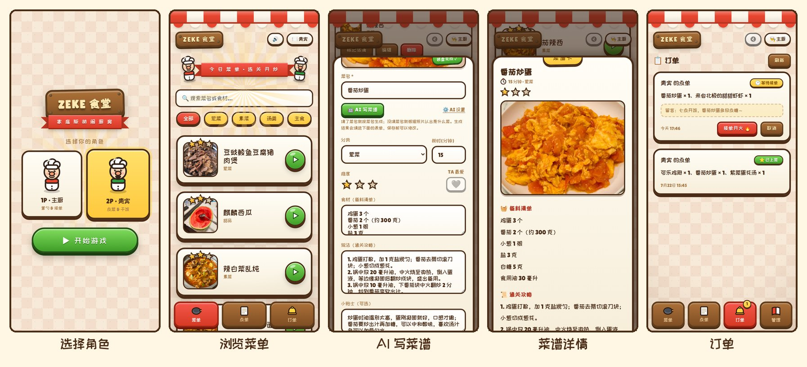
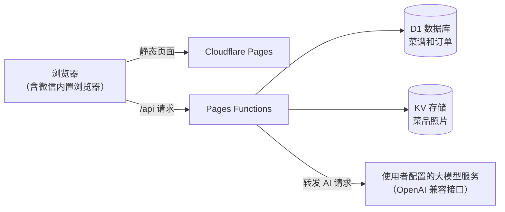
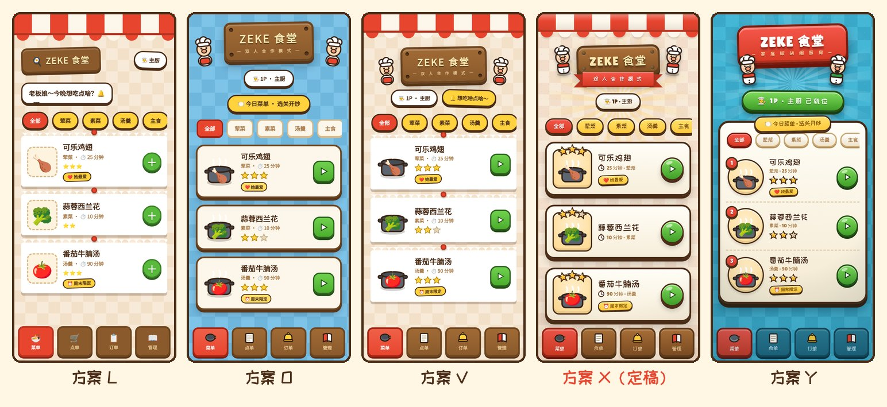

# 🍳 Zeke 食堂 · Table for Two

为情侣两人居家做饭设计的点菜与菜谱网页应用。一人掌勺，记录拿手菜；另一人像在餐厅里一样翻菜单、点菜、给主厨留言，订单从下单到上菜的状态两人都能实时看到。界面采用游戏风格，配有原创手绘素材和合成音效。

**在线体验**：https://zeke-shitang.pages.dev

演示站点对所有人开放，可以随意点菜、添加和编辑菜谱。



[](https://github.com/zeke2997/table-for-two/actions/workflows/test.yml)


## 功能

- **两个角色**：打开网页先选角色。主厨负责管理菜谱和处理订单，贵宾负责点菜。两个角色的名称可以在配置里修改。
- **菜单**：按分类浏览，按菜名或食材搜索，查看菜谱卡片，加入点单。
- **点单**：调整份数，给主厨留言，提交订单。
- **订单**：主厨可以接单、完成或取消订单，贵宾能看到每一单的进度。
- **菜谱管理**：添加、编辑、删除菜谱，上传菜品照片，标记“今日估清”和“TA 最爱”。
- **AI 写菜谱**：输入菜名，或者只拍一张菜品照片，由大模型生成食材用量、做法步骤、耗时和难度，直接填进表单。大模型接口由使用者在网页里自行配置，支持任何兼容 OpenAI 接口的服务。
- **微信可用**：针对微信内置浏览器做过专门的兼容处理，链接发到微信里可以直接打开。

## 技术架构



| 部分 | 选型 | 说明 |
|---|---|---|
| 前端 | 原生 HTML、CSS、JavaScript | 没有构建步骤，也不依赖前端框架。微信内置浏览器加载大体积脚本时会静默卡住，所以页面只用原生代码，字体也放在本地。 |
| 接口 | Cloudflare Pages Functions | 代码在 `functions/api/`，按文件路径自动生成路由。 |
| 数据 | Cloudflare D1（SQLite） | 存菜谱和订单，表结构见 `migrations/`。 |
| 照片 | Cloudflare Workers KV | 照片按文件名存取，浏览器端长期缓存。 |
| 测试 | Node.js 内置测试框架 | 单元测试覆盖服务端校验，接口测试在本地服务器上跑完整流程，GitHub Actions 在每次提交时自动运行。 |

**运行成本**：全部在 Cloudflare 免费额度之内，不需要绑定信用卡。超出额度时请求会失败，不会产生任何费用。两人日常使用的用量与额度相差几个数量级。

| 资源 | 免费额度 |
|---|---|
| Pages Functions 请求 | 每天 10 万次 |
| D1 | 每个数据库 500 MB，每天读取 500 万行、写入 10 万行 |
| KV | 1 GB，每天读取 10 万次、写入 1000 次 |

## 安全设计

演示站点没有登录，接口对所有人开放读写，所以把关放在服务端。

- **输入校验**：接口只接受规定的字段，限制每个字段的长度和取值范围。照片只接受 1 MB 以内的 JPEG、PNG 和 WebP，菜谱总数上限为 500 道。
- **资源清理**：更换照片或删除菜品时，旧照片同步删除，存储不会无限增长。
- **费用兜底**：账号不绑定信用卡，即使接口被恶意调用，后果也只是当天额度用完。
- **进入口令**：`public/config.js` 里可以设置口令，用来防止陌生人误入。口令在前端校验，属于一道软门槛。
- **AI 密钥**：使用者的 API Key 只保存在自己的浏览器里。生成菜谱时请求经服务端转发，以避开浏览器的跨域限制，服务端不保存密钥，也不写日志。转发接口只接受 https 地址，请求内容由服务端按固定模板组装，无法被用来转发任意请求。

## 部署你自己的一份

需要一个 Cloudflare 账号（免费）和 Node.js 20 以上版本。完整步骤见 [部署教程](docs/deploy.md)，大致流程如下：

```bash
git clone https://github.com/zeke2997/table-for-two.git
cd table-for-two
npm install
npx wrangler login
npx wrangler d1 create table-for-two          # 把输出的 database_id 填进 wrangler.toml
npx wrangler kv namespace create PHOTOS       # 把输出的 id 填进 wrangler.toml
npm run db:migrate:remote
npx wrangler pages project create <项目名> --production-branch main
npm run deploy
```

部署完成后得到 `https://<项目名>.pages.dev`，发到微信里就能用。

## 本地开发

```bash
npm install
npm run db:migrate:local   # 初始化本地数据库
npm run dev                # 启动本地服务器 http://127.0.0.1:8788
npm test                   # 单元测试
npm run test:api           # 接口测试，需要先启动 npm run dev
```

本地服务器使用模拟的 D1 和 KV，数据保存在 `.wrangler/` 目录，不会影响线上。只想看看界面的话，把 `public/config.js` 里的 `DATA_MODE` 改成 `"local"`，数据就只存在浏览器里，不需要后端。

开发约定和微信兼容方面的注意事项见 [DEV.md](DEV.md)。

## 项目结构

```
table-for-two/
├── public/                  # 网页，原样部署
│   ├── index.html           # 页面结构、SVG 素材、抢救加载器
│   ├── config.js            # 使用者配置：口令、角色名称、默认分类
│   ├── css/style.css
│   ├── js/store.js          # 数据层：调用 /api，或者使用浏览器本地存储
│   ├── js/app.js            # 页面逻辑、AI 写菜谱、合成音效
│   └── debug.html           # 线上诊断页，排查微信兼容问题用
├── functions/api/           # 后端接口，按文件路径生成路由
├── lib/                     # 接口共用的校验、AI 请求组装与结果解析
├── migrations/              # D1 表结构
├── tests/                   # 单元测试和接口测试
├── docs/                    # 部署教程和图片
└── wrangler.toml            # Cloudflare 资源绑定
```

## AI 协作开发

这个项目从界面设计到上线运维，都是我与 AI 编程助手 [Claude Code](https://claude.com/claude-code) 协作完成的。我负责提出需求、做技术取舍和验收结果，AI 负责调研、编写代码、测试和部署。下面几个做法是这次协作里比较关键的部分。

**用文档保存项目记忆。** 仓库里的 [CLAUDE.md](CLAUDE.md) 记录架构、开发约定和踩过的坑，AI 每次开工先读它；[DEV.md](DEV.md) 记录开发流程和进行中的任务。换电脑、换会话之后，AI 能直接接上之前的进度。

**先比较方案，再动手。** 界面先后做过多套风格方案，按字母编号，放在一起反复比较后选定 X 方案，再细化成现在的样子。下图是保留下来的其中五套。



**定位疑难问题。** 2026 年 7 月，网站在微信里整页失灵，而且没有任何报错。排查后确认，微信内置浏览器会静默卡住体积较大的脚本，当时使用的数据库官方 SDK 正好属于这种情况。解决办法是改用原生 fetch 实现数据层，同时在页面里加了一个用 XHR 兜底的“抢救加载器”和线上诊断页 `/debug`。

**整体迁移架构。** 2026 年 10 月，原先使用的 Supabase 免费项目因为闲置被自动暂停，网站随之失效。我和 AI 比较了几种方案后，决定迁到 Cloudflare Pages、D1 和 KV，这样就没有闲置暂停的问题。迁移分六步推进，每一步验收后再进入下一步。AI 完成了后端重写、旧数据和照片的迁移核对，以及测试编写。恢复暂停的数据库、创建 Cloudflare 访问令牌这类只能在网页控制台里完成的操作，由我登录账号后交给 AI 通过浏览器自动化完成。

**用测试验证每一次改动。** 服务端校验逻辑有单元测试，接口有端到端测试，AI 功能用模拟的大模型服务测试，同时用真实服务商做过验证。每次提交都会在 GitHub Actions 上自动运行全部测试。

## 致谢

- 界面风格参考了游戏《胡闹厨房》（Overcooked），页面中的小厨师、炖锅、星星等图形均为原创绘制。
- 字体使用 [站酷快乐体](https://fonts.google.com/specimen/ZCOOL+KuaiLe) 和 [Lilita One](https://fonts.google.com/specimen/Lilita+One)，均以 SIL Open Font License 1.1 授权。

## 许可证

[MIT](LICENSE)
